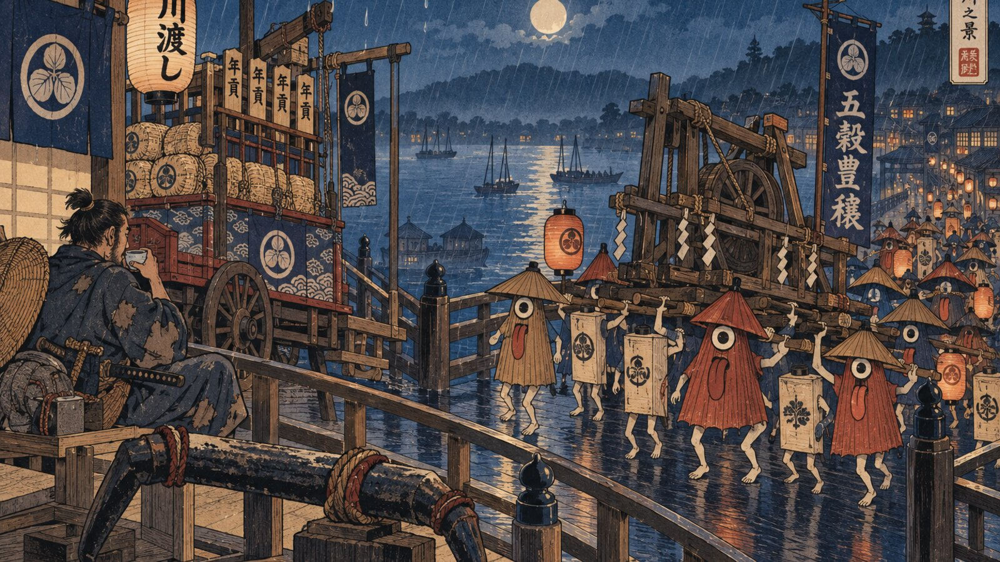

# Astro-Arc

**Your desktop, generated from your birth chart — every day.**

Astro-Arc is an [Omarchy](https://omarchy.org) bar-widget plugin. It reads your
natal astrology chart and the day's transits, turns them into a psychological
reading, turns that into a single image, renders it, and derives a matching
colour palette from the rendered image — so the wallpaper and the theme always
agree, because the theme is made *from* the wallpaper.

It runs on a cadence you pick, and every generation is browsable, exportable and
shareable.



---

## Seven worlds, not seven filters

Every style is a **world** with its own era, materials, physics, inhabitants,
myths and rules: what lives there, how it goes dark, what the eye should find
first, and the one thing that marks a picture as unmistakably that world. The
same day's reading, rendered in each:

| Hand-Painted Anime | Cyberpunk | Cosmic |
| --- | --- | --- |
|  |  |  |
| **Antique Engraving** | **Ukiyo-e** | **Symbolist** |
|  |  |  |
| **Illuminated Manuscript** | | |
|  | | |

**[What each world is, and how it was built →](docs/styles.md)** ·
**[Make your own →](docs/charter-schema.md)**

---

## How it works

The chart never reaches the picture directly. It goes through meaning first:

1. **The reading.** Your natal chart and the day's transits become a short
   psychological reading in a Jungian frame, written by a model that is
   forbidden any visual language, so the picture cannot be decided by a cliché
   ("Mars square Moon" never becomes "a red sword").
2. **The myth.** The reading becomes an archetypal situation and the someone or
   something in it, found in the chosen world's own myths: a Ghibli river god, a
   kami living in a junction box, a constellation walking the sky.
3. **The material.** That myth is built out of the day's material register
   (stone, water, paper, machinery and sixteen more) in the world's own terms,
   with one highlight for the eye to find first.
4. **The picture.** A composition brief, a style's rules and its technique turn
   it into an image prompt; the image is rendered and its own colours become the
   desktop palette.

## Why no two days look alike

The chart decides the **shape** of the picture as well as its subject. Four
measurements of the day (how hard the aspects are, how exact, how many, and how
much of the Moon is lit) set how many things are in frame, how many places they
occupy, how close the event sits, whether the two materials collide or cohere,
and how much of the frame is dark. A loaded, hard day is crowded and close; a
quiet one is not.

Then the world draws the rest from its own lists, never repeating what it drew
in its last runs: what is happening to things, what the people are doing (work,
but just as often rest, play, ritual or travel), how the frame shows depth, how
worn things are, and what kind of strangeness the highlight has. The last runs'
objects and myths are passed back in as already spent.

None of this is a filter on a fixed scene. In a 56-image test of all seven
styles on the same two days, no two worlds shared more than 4% of the things
they put in frame.

## Requirements

- **Omarchy.** This is a bar-widget plugin; it does not run standalone.
- **An OpenAI API key.** Every stage is an API call, so a key is required
  regardless of which models you pick.

That is all. There is no install step: nothing is compiled, nothing is
downloaded, no service is registered. The backend runs on the Python and
ImageMagick every Omarchy install already has, using the standard library only,
and the chart maths is [Astronomy Engine](https://github.com/cosinekitty/astronomy),
vendored in this repository as a single file.

## Install

From Omarchy's plugin marketplace, or:

```sh
omarchy plugin add https://github.com/Gmacadoches/astro-arc.git --enable
```

Then click ✦ in the bar, paste your API key, and enter your birth date, time
and place.

Nothing generates on its own until you say so: **Schedule** starts at **None**,
so the first theme is the one you ask for with **Regenerate**. Set it to Hourly,
Daily, Weekly or Monthly once you know what a run costs you — the panel prices
the month for whichever you pick. Hourly gets a second picker for every 1, 2,
3, 4, 6, 8 or 12 hours, and the slots line up with the clock (every 3 hours
runs in the 00:00, 03:00, 06:00 ... slots).

A schedule only advances while you are logged in, because the widget itself is
the scheduler. A locked screen still counts; being switched off, asleep or
logged out does not, and anything that came due during that runs within a few
minutes of your being back rather than being skipped.

**Update:** `omarchy plugin update garrett.astro-arc`. The plugin never
updates itself — the panel shows which release you are on and leaves the
updating to Omarchy.
**Remove:** `omarchy plugin remove garrett.astro-arc`. Your archive stays —
see below.

## Your archive

Every generation is kept as a page of its own — the image, the reading, the
prompt and what it cost — together with its complete theme, in
`~/.local/share/astro-arc/`. Under **Themes Generated** in the panel, pick a
generation and then **Open** its page, **Browse** the whole gallery
(`~/.local/share/astro-arc/index.html`: every generation, newest first — bookmark
it), or **Set Theme** to put that generation's colours and wallpaper back on the
desktop. Set Theme is temporary by design: the next generation replaces it, and
**Save Theme** is how one becomes a permanent Omarchy theme.

To send one to someone, **Share Record** writes that generation as a single
`.html` file — the image, the reading, the prompt and the costs, all inside the
one file, so it opens anywhere with no folder around it. It asks where to save.
(**Export** is the other direction: it packages the *theme* as a git repo
someone can install with `omarchy theme install`, and leaves the reading out.)

Uninstalling the plugin leaves your archive untouched, because it was always
just files in your home directory. Delete the folder when you no longer want
it. *History* in Settings sets how long generations are kept; the newest is
never pruned.

## What it costs

Real measured costs, not estimates from a rate card. One preset sets every
model at once:

| Preset | Per run | Per month (daily) |
| --- | ---: | ---: |
| Low | $0.008 | **$0.23** |
| Medium | $0.011 | $0.32 |
| **High** *(recommended)* | $0.031 | **$0.93** |
| Ultra | $0.076 | $2.32 |
| Maximum | $0.210 | $6.39 |

Above roughly $0.05 a run, nothing got measurably better in testing — the upper
tiers buy a stronger *writing* model, not a better picture. Low already produces
a good image.

Figures are measured on this project's own renders and will drift as model
prices change; the widget always shows the live number, what your next click
will charge, and whether that figure is measured or projected.

You can set a hard ceiling per image, and every model your key can reach is
selectable in the Advanced popout if you want to tune it yourself.

## Sharing a theme

Any generation can be exported as a standalone Omarchy theme repository —
palette, wallpaper, preview thumbnail and README. Push it to a git host and
anyone can install it:

```sh
omarchy theme install https://github.com/you/omarchy-your-theme.git
```

Exports deliberately contain no personal content: the palette, the image and the
image prompt, never the reading that produced them.

## Your data

- **Your API key lives only in the system keyring** (`secret-tool`). Never in a
  file, an environment variable, a command line, or this repo. See
  `backend/bin/astro-arc-apikey`.
- **Your birth data and your readings stay on your machine**: settings in
  `~/.local/state/omarchy/settings/astro-arc.json`, caches in
  `~/.local/state/omarchy/astro-arc/` (safe to delete), your archive in
  `~/.local/share/astro-arc/`. Nothing in this repository contains them.
- Your prompts and chart facts are sent to OpenAI to generate each image, which
  is the entire mechanism — if that is not acceptable to you, this is not the
  tool for you. The birth place is looked up with Open-Meteo's geocoder, which
  also supplies its timezone.

## Tuning it

Several tables are plain TOML, read fresh on every run, so an edit takes effect
on the next generation with no restart and no code change. [`PIPELINE.md`](PIPELINE.md)
says which step each one changes:

| File | What it controls |
| --- | --- |
| `backend/pipeline/styles/` | the seven shipped styles, one `<key>.toml` + `<key>.jpg` preview each: each one's technique and its world (see [`docs/charter-schema.md`](docs/charter-schema.md)) |
| `backend/pipeline/registers.toml` | the 20 material registers a scene is built from |
| `backend/pipeline/actors.toml` | the kinds of actor a scene can have, from a lone person to a swarm |
| `backend/pipeline/model-rates.toml` | model prices, quality presets, shortlists |
| `backend/pipeline/cliches.toml` | imagery to block when it starts recurring (empty by design) |

## Documentation

- [`PIPELINE.md`](PIPELINE.md) — **start here.** How one image gets made, step by
  step, with the config knob that changes each step. Written for someone who
  just forked this and wants to retune it without reading any Python. Also
  published as a page at [`docs/pipeline.html`](docs/pipeline.html), generated
  from that file by `backend/bin/build_pipeline_page.py` — edit the Markdown,
  run the script, never edit the HTML.
- [`RELEASING.md`](RELEASING.md) — how a release is cut (`bin/release`), why
  `master` only ever holds releases, and how updates find them.
- [`docs/styles.md`](docs/styles.md) — the seven worlds, each rendered from
  the same reading and register, with what defines each one.
- [`docs/charter-schema.md`](docs/charter-schema.md) — every field of a style's
  world, what it controls, and how to write one well: the reference for making
  your own style.

Each script carries its own header comment explaining what it does and why it
does it that way; that is the reference for anything PIPELINE.md does not cover.

## Licence

[GNU Affero General Public License v3.0 or later](LICENSE).

Charts are computed with [Astronomy Engine](https://github.com/cosinekitty/astronomy)
by Don Cross, vendored unmodified in `backend/vendor/astronomy/` under the MIT
License. See [`NOTICE`](NOTICE) for the third-party notices.
