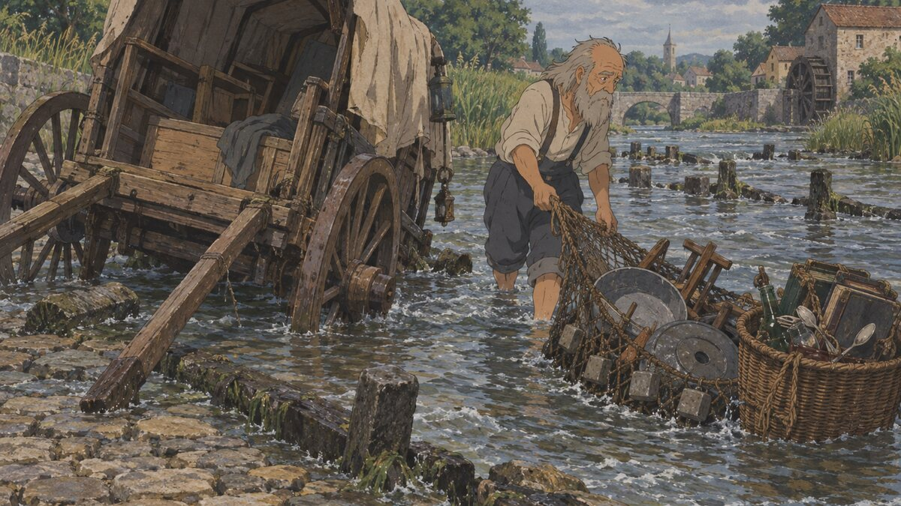
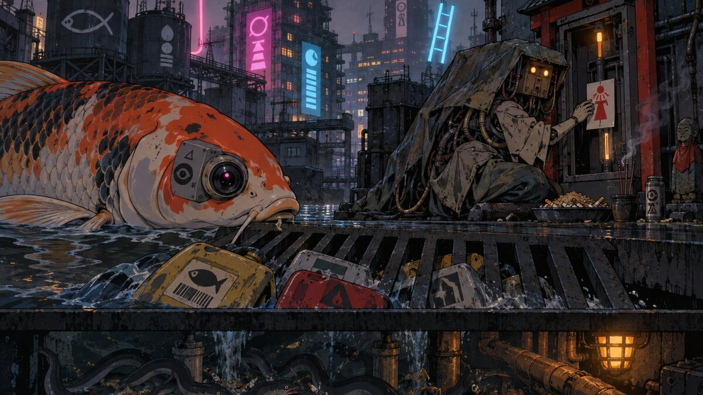
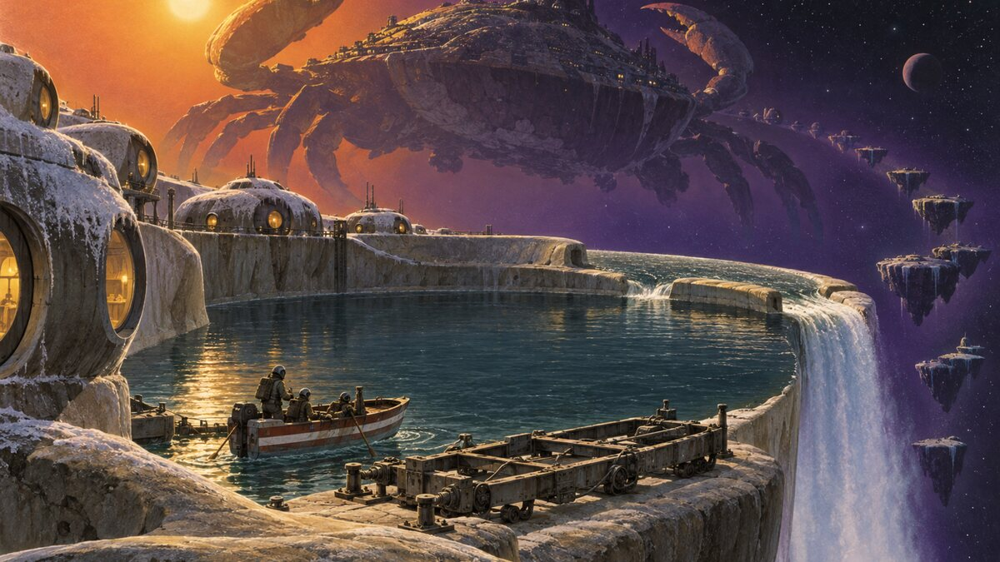
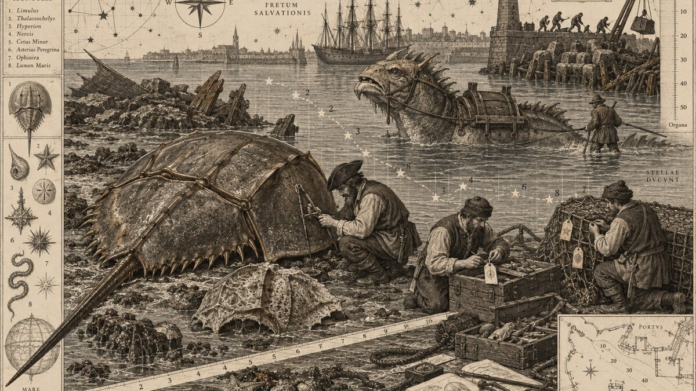
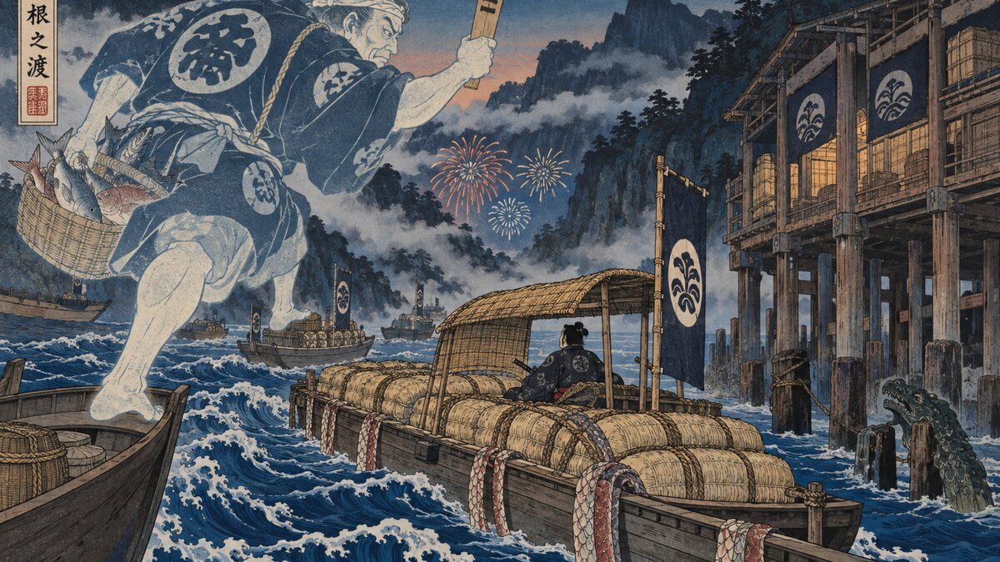
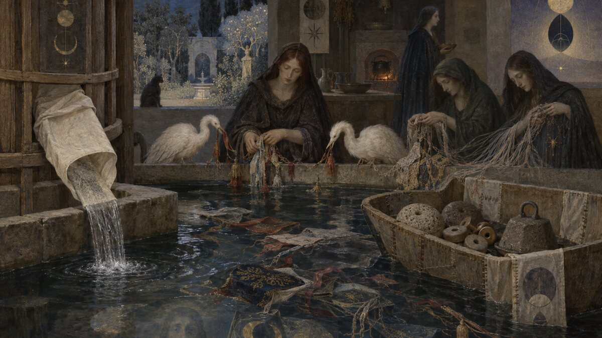
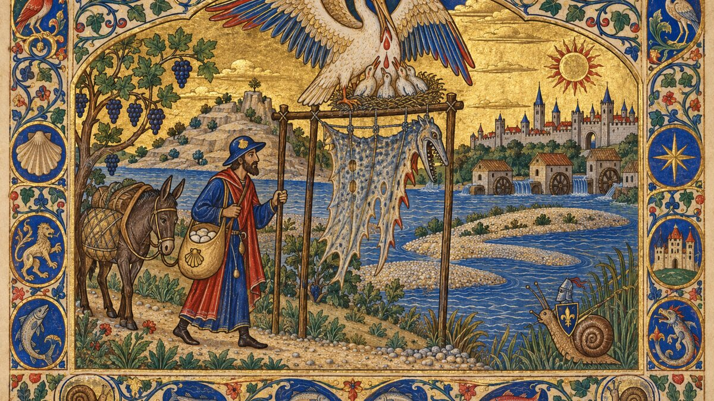

# The seven worlds

Each style in [`backend/pipeline/styles/`](../backend/pipeline/styles/) is a technique and a **world**: a charter that says what the world is made of, who lives there, which myths its stories come from, what its highlight is, and the one thing that marks a picture as unmistakably that world. [`charter-schema.md`](charter-schema.md) describes every field.

Every image below is the **same day's reading** and the **same material register** (`aquatic`), rendered at the same settings. Each world built its own scene from them: that is the point. Change the style from the widget's Style dropdown; the file is read fresh on every generation.

## Studio Ghibli

`ghibli`

**The world.** Early-industrial in feeling, with engineering that is impossible and that nobody minds: machines walk, fly and have faces, and a building may have legs. Everything is hand-built, far oversized for its job, and kept running by someone who loves it. Technology here is a character, not a backdrop.

**Its stories come from:** Shinto kami, the spirits of particular places and the gods of rivers, hills and forests; Japanese folklore of tricksters, shapeshifters and the child spirited away into a world of spirits; and the European fairy tale these films also draw on, of witches' apprentices, cursed shapes and castles that move.

**What marks it.** At least one thing in frame could not exist, and nothing in the scene treats it as remarkable; it may be the highlight. Give it this world's own form: a machine that is plainly alive or awake, a spirit holding a job, a creature far too large for its kind, or a building that walks or flies.

The prompt for this image

> At a scoured ford under cold side light, a roofed handcart lies beached in the shallows, road shafts and spoked wheels still harnessed, filling the foreground while water settles around its boards. An old river god in rolled work clothes wades past its axle, dragging a knotted hemp net weighted with tile sinkers, full of tin washbasins, stove lids, and snapped chair legs for culling. Beside him, a wicker eel-creel packed with bottle shards, bent cutlery, and sodden account books cools in the current. Paving stones and water-smoothed joists run with the river away into reed banks and low mills.

## Cyberpunk

`cyberpunk`

**The world.** A future that arrived decades ago and has been kept running ever since. Nothing is new: machines are bolted onto older machines and towers built over the roofs of earlier towers. The technology is powerful and long past its prime, and most of it is kept alive by people who were never meant to maintain it.

**Its stories come from:** Loa, orisha, saints and kami living in hardware: the spirits of Vodou and Santería riding machines instead of people, saints whose days are kept at junction-box shrines, and tsukumogami, the objects that come alive after a hundred years of use and are fed so they stay kind.

**What marks it.** At least one thing marks this as the used future, named explicitly: a body with visible hardware, a machine bolted onto an older one, or signage traced in neon tube. It may be the highlight or the actor.

The prompt for this image

> Dominating the frame, an intake carp with a camera-lens tag grown into its skull noses a storm-drain grate, turning at every movement while split, price-stamped jerrycans choke the sluice teeth below. Beside it, an old junction-box kami under tarpaulin skin pastes a prayer sticker onto a fed busway shrine stripped to one live feeder spine, incense dimming beside rice hulls and cigarette filters in the catch pan. Under the service floor, drain eels knot and feed where washwater and heat buzz around the kami’s footing. Grey light and two neon tubes—one bent into a hooked loop, one into a broken ladder—flicker across rooftop tanks, antennas, and stacked towers.

## Cosmic / Nebula

`cosmic`

**The world.** The space age as 1970s paperback covers painted it: people living on rock that hangs in open sky and working among hulls someone else built. Technology is heavy, hand-flown and painted in hazard stripes, never sleek and never a touchscreen.

**Its stories come from:** The sky myths of many peoples, in which the stars are beings and their stories are still happening: heroes and animals set among the stars, and the sky as a goddess's body with the sun's boat crossing it each night.

**What marks it.** The land visibly hangs in space: a horizon or an island edge drops away into black void or a gradient sky, and at least one thing at celestial scale (a planet, a ring, a star-being) is in frame and named. A scene that could be taking place on Earth is a failed response.

The prompt for this image

> Under the whole lit claw and black stump of Cancer, a world-sized crab of rock and hull plate orbiting over the channel, a salvage crew sculls a striped skiff along the emptied crab-shell cistern quarried into the island, docking beside the bare tow-sled frame. Water rocks at anchor in the basin, then pours through the spillway notch cut in the floating lip and off into the violet void toward the next island. Round-windowed pod dwellings cling to the rim; their shaded sides are frosting over under the hard one-sided star.

## Antique Engraving

`engraving`

**The world.** The engraved universe of the natural philosophers, from the first star atlases to the encyclopaedias: a world measured, labelled and cut open to show how it works, where the heavens are drawn as figures over the stars and the earth is drawn in section.

**Its stories come from:** The Greco-Roman myths behind the constellations, Perseus and the sea monster among them, and the emblem books of the Hermetic philosophers, where the world above mirrors the world below.

**What marks it.** The star chart is in the world: at least one named element of celestial cartography (a constellation figure, numbered stars, a graticule line, a cartouche) runs from the edge of the image into the scene and merges with it. A plate that could be any old etching is a failed response.

The prompt for this image

> An outsized horseshoe crab dominates the foreground tide shelf, its split moult laid off, a measuring line aligning beside the carapace while numbered stars and a graticule run from the plate edge into the harbour water. A ship’s company kneels against it, cataloguing specimens and pressing tags into a sealed casket raised from a snagged cargo net under depth marks. Beside them a chart-margin sea monster, taken in hand as a towing beast, floats with an emptied pack-saddle. Along the breached mole, anchor-stones seed one salvage pile and rotten fenders another under raking light.

## Ukiyo-e

`ukiyoe`

**The world.** Edo Japan's floating world, 1603 to 1868: post roads and ferries, wooden cities on rivers, kabuki and festivals, and a supernatural that walks the same streets after dark. Technology is wood, paper, rope and lacquer, carried by hand and on horseback.

**Its stories come from:** Japanese folklore and kaidan ghost tales, yōkai, Shinto kami, Buddhist hells and heavens, and heroic legends like the warrior who killed the earth spider.

**What marks it.** At least one thing marks this as Edo Japan, named explicitly: a post-road station, a wooden bridge, a lacquered shop sign or a yōkai. It may be the highlight.

The prompt for this image

> At a post-road ferry on a mountain pass river, a ghost fishmonger, huge in the foreground, climbs the sky from boat to boat with tally-slat raised over a tribute rice barge curling up into the current. Beneath him, a solitary warrior sits under the barge's straw canopy watching evening fireworks, using banner-length lashings cut from the water-serpent's flensed hide. Beside the hull, the river god's drowned storehouse stands lifted clear of the mudbank, cedar pilings and plank bins newly set, their wet faces half lit. Mist patterns over the pass behind.

## Symbolist / Visionary

`symbolist`

**The world.** No single era: the dream-world of the Symbolist and Surrealist painters, where towers, vehicles and kitchens from old Europe and old Mexico house rites nobody explains. Its technology is handmade and impossible, like a bicycle that weaves as it rides or a tower that spins thread.

**Its stories come from:** Alchemy and Hermeticism, Celtic and Mexican folklore, Theosophy, and Greek myth as the Symbolists painted it: the work of transformation, the descent to the underworld, the weaving of fate.

**What marks it.** At least one impossible apparatus, or a body partly turned into something else, is named explicitly and doing something. It may be the highlight.

The prompt for this image

> A cistern-chamber with ribbed wooden walls and a throat of folded linen fills the foreground, pouring slowly into a stone-lipped inlet across an open kitchen to a moonlit garden. A household of cloaked women feed two white waterbirds at the washing place, their sleeves melting into thread harness while they sort what the water keeps. Beside them, a plankwood wash-boat of stitched cloth rocks, loaded only with bread-stones, spindle whorls, and a basin-weight. Purse linings and snapped bindings weave themselves under the surface, and the birds tug ribbons and tassels away along the lip.

## Illuminated Manuscript

`illuminated`

**The world.** The high and late Middle Ages as the manuscript painters saw them: walled towns, castles, monasteries and fields worked through the turning year, under a sky of gold. Technology is the plough, the mill, the loom and the sword.

**Its stories come from:** Saints' legends, the bestiary (the pelican feeding its young with its blood, the whale mistaken for an island), Arthurian romance, and the zodiac and the children of the planets.

**What marks it.** The page is in the world: a labour or feast of the month, a zodiac roundel, or a creature from the border reaching into the scene, named explicitly. A picture that could be any medieval-looking painting is a failed response.

The prompt for this image

> A pilgrim leads a mule along the riverbank under a gold sky, one hand on a bulging scrip stuffed with salt-cakes, the other steadying a fish-drying frame where the sea-dragon’s emptied skin rings out in the wind. Over the frame towers a pelican, larger than horse and man, roosting on the crossbeam and opening its own breast above a nest of half-fledged young. Beside the path the spit of shingle fruits the false island’s bare back-bones into the shallows; upstream, mills step the river toward a walled town, while a snail-knight from the vine border noses into the reeds.

